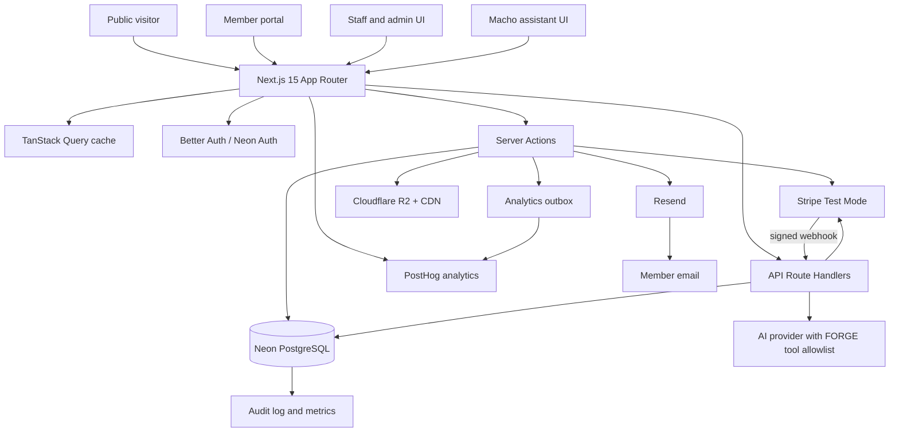
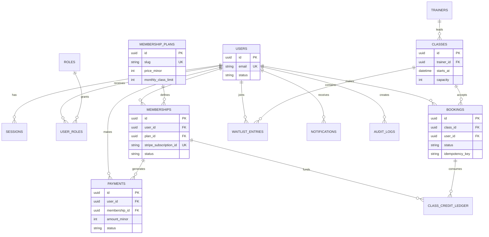

# FORGE Studio Platform Architecture

Status: pre-development blueprint

## Architecture Decisions

### Multi-tenancy

Recommendation: introduce a lightweight tenant model before implementation, even though the first deployment has one gym. The migration cost is small now and much higher after classes, memberships, bookings, and payments contain production data.

- Add `gyms` as the root tenant table with `id`, `slug`, `name`, `timezone`, `default_currency`, `active`, and timestamps.
- Add `gym_id` to `trainers`, `classes`, `bookings`, `memberships`, and `payments`, with non-null foreign keys and indexes. Also scope `waitlist_entries`, `check_ins`, `notifications`, `feature_flags`, and `analytics_events` where the record represents a gym operation.
- Keep `users` global. A person can belong to more than one gym, while `memberships` and permissions are evaluated in a selected gym context. `user_roles` should become `user_gym_roles` for gym-scoped roles; platform roles remain separately assignable to super admins.
- Enforce tenant context in repository functions and authorization checks. Never accept a client-provided `gym_id` without verifying that the session has access to it.
- Composite indexes begin with `gym_id` for operational queries. This adds one equality predicate but keeps selectivity high and supports future partitioning if a location grows substantially.
- The first migration is additive and seeds one `FORGE Studio - Accra` gym. Future locations are inserts, not a schema rewrite.

This is a deliberate middle ground: tenant isolation is present at the data and authorization boundaries, but there is no premature per-tenant infrastructure or separate database for each location.

### Media storage

Recommendation: Cloudflare R2, fronted by Cloudflare CDN, rather than Neon Object Storage. Media is not transactional gym data; R2 gives a clean object-storage boundary, S3-compatible tooling, predictable egress economics, and signed upload/download URLs.

- Store only object keys, content type, dimensions, alt text, and ownership metadata in PostgreSQL.
- Upload through a server-generated presigned URL after validating role, gym scope, file size, MIME type, and allowed asset purpose.
- Process images into responsive WebP/AVIF derivatives and serve them through a CDN hostname. Never store uploads on the local filesystem.
- Keep separate buckets or prefixes for local, preview, and production. Browser access is public only for approved marketing assets; originals and private assets require signed URLs.
- Restrict CORS to the application origins, scan uploads, strip unsafe metadata where practical, and enforce object-key ownership on replacement/deletion.

### Feature flags

Use a database-backed `feature_flags` table for named flags and environment variables for emergency overrides. A flag has `key`, `description`, `enabled`, optional `gym_id`, `rollout_percentage`, `targeting`, and timestamps.

Evaluation is server-side by default and receives a stable subject (`user_id`, anonymous ID, or gym ID). Environment overrides are explicit `FEATURE_FLAG_<KEY>=on|off`, take precedence over database values, and are never exposed as secrets. Rollouts begin at 0%, move to internal staff, then a percentage of stable hashed subjects, and finally 100%; flag changes are audited. Client code receives only the evaluated result needed by that screen.

Initial keys: `ai_assistant`, `waitlist_system`, `experimental_booking_flow`, `admin_analytics_v2`, and `referral_program`.

### Analytics

Recommendation: PostHog is the production product analytics system, with a small `analytics_events` table used as a durable outbox for important server-side events and reconciliation. Do not make PostgreSQL the primary warehouse for every page view.

Track `membership_viewed`, `membership_selected`, `checkout_started`, `checkout_completed`, `class_booked`, `class_cancelled`, `ai_chat_started`, `ai_chat_completed`, and `trainer_profile_viewed`. Events contain a schema version, anonymous/user ID, gym ID, timestamp, and non-sensitive properties. Never send payment details, private member data, passwords, or full chat contents to analytics. Consent controls browser analytics; server billing events remain attributable only after the applicable privacy basis is established.

### Macho security boundary

Macho is a public/member-facing read-only assistant. Its tool registry contains only approved public FORGE data and returns typed, redacted results. It cannot access payment records, passwords, sessions, private member data, admin data, internal operational data, or arbitrary database queries. Tools run in a separate service layer with an allowlist, timeout, output-size limit, and audit-safe telemetry. Requests are rate-limited per IP and authenticated user, with a stricter per-user daily budget. Tool failures return a safe fallback and never reveal internal errors.

#### Tool contracts

All five tools take `{}` as input and receive a server-created `ToolContext` containing `gymId`, `subjectId`, and `isAuthenticated`; callers cannot choose another gym. Outputs are typed summaries, not database rows.

| Tool | Output | Access | Failure behavior |
|---|---|---|---|
| `getMembershipPlans()` | Active plan slug, name, integer USD price, and class limit | Public; public plans only | Return a temporary-unavailable response and log an error code |
| `getTodayClasses()` | Published class ID, name, ISO start/end, trainer name, remaining capacity | Public; availability is non-sensitive | Return an empty unavailable state; never expose SQL/provider errors |
| `getTrainerProfiles()` | Name, public bio, and specialties | Public profiles only | Return a safe fallback |
| `getOpeningHours()` | Day, opening time, closing time | Public gym data | Return configured fallback hours or unavailable state |
| `getFacilities()` | Facility name and public description | Public facility data | Return a safe fallback |
| `getSignupLink()` | Relative registration path | Public | Static response; no database access |

Tool execution is capped by a 3-second timeout and a bounded output size. The assistant endpoint is limited per IP and authenticated subject, rejects oversized messages, and records only event name, outcome, latency, gym ID, and error code. No tool may call payment, identity, admin, audit, or arbitrary SQL repositories.

### Observability

Use Sentry for frontend and backend errors, with source maps uploaded during CI and sensitive request data scrubbed. Use structured JSON logs with request ID, trace ID, route, actor ID, gym ID, action, duration, result, and error code. Do not log tokens, payment payloads, passwords, or raw assistant conversations.

Alert on elevated 5xx responses, booking transaction conflicts, failed Stripe/webhook processing, repeated AI/tool failures, auth failures, and database latency. Audit logs remain the authoritative trail for role changes, membership changes, booking overrides, refunds, check-ins, media changes, and feature-flag changes; Sentry links to the relevant request and audit IDs.

### Currency and billing

Recommendation: launch with USD as the canonical billing currency because the approved catalog is `$129`, `$169`, and `$219` and changing it to GHS without a commercial decision would silently change prices. The UI must label prices as USD, and Stripe Price IDs must be configured per environment rather than generated from display values.

The schema remains currency-aware (`currency` plus integer minor units). Before enabling GHS, confirm the Ghana Stripe account and payout configuration support the required charge currency, create a separate GHS catalog with explicit prices, and migrate customers through a planned product decision. Do not perform live FX conversion at checkout. Multi-currency later means separate price records/Stripe Price IDs, currency-aware invoices, and a member-selected billing currency recorded on the subscription.

The initial seed uses USD minor units `12900`, `16900`, and `21900`, with `default_currency = 'USD'` on the seeded Accra gym. Currency is configuration, not a hard-coded UI assumption.

## 1. System Architecture

FORGE Studio is a Next.js application deployed to Vercel. The browser uses server-rendered public pages and authenticated portal/admin pages. Server Actions handle mutations initiated by the web UI; Route Handlers expose webhook and integration endpoints. PostgreSQL is the source of truth for tenants, members, memberships, schedules, bookings, payments, roles, flags, analytics outbox events, and audit events. Cloudflare R2 stores media and PostHog receives consented product analytics.



### Runtime boundaries

- `app/(marketing)`: public, SEO-oriented pages with static or cached content.
- `app/(auth)`: registration, login, password reset, and session flows.
- `app/(portal)`: authenticated member experience. Every query is scoped to the current user.
- `app/(admin)`: staff/admin experience protected by permission checks, not only UI hiding.
- `app/api/webhooks/stripe`: the only Stripe webhook entry point; verifies the raw request body and signature.
- `src/server`: database access, domain services, authorization, integrations, and validation. UI components do not write directly to the database.
- `src/server/media`: presigned R2 uploads, asset metadata, and access checks.
- `src/server/flags`: gym-aware feature-flag evaluation with environment overrides.
- `src/server/assistant`: typed public-data tools only; it cannot use general database access.

### Core request flow

1. Validate input with Zod at the boundary.
2. Resolve the authenticated session and required permission.
3. Execute a domain service inside a transaction where state can race.
4. Write an audit event for privileged or financial changes.
5. Enqueue or send side effects after the primary transaction succeeds.
6. Return a typed result or a stable error code to the UI.

## 2. Database Schema

Neon PostgreSQL is the canonical store. All IDs are UUIDs. Timestamps are UTC `timestamptz`. Money is stored as integer minor units plus an ISO currency code; never use floating point for billing.

### Tenancy, identity, and authorization

| Table | Important columns | Constraints and notes |
|---|---|---|
| `gyms` | `id`, `slug`, `name`, `timezone`, `default_currency`, `active` | Root tenant; seed `FORGE Studio - Accra` |
| `users` | `id`, `email`, `name`, `phone`, `status`, `created_at` | Unique normalized email; status includes active, suspended, deleted |
| `sessions` | `id`, `user_id`, `expires_at`, `ip_address`, `user_agent` | Managed by Better Auth; indexed by user and expiry |
| `roles` | `id`, `name` | member, staff, admin, super_admin |
| `user_gym_roles` | `user_id`, `gym_id`, `role_id` | Composite primary key; member/staff/admin scoped to a gym |
| `platform_roles` | `user_id`, `role_id` | Super admin and platform-level permissions |
| `audit_logs` | `id`, `actor_user_id`, `action`, `entity_type`, `entity_id`, `metadata`, `created_at` | Append-only; redact secrets and payment data |

### Gym domain

| Table | Important columns | Constraints and notes |
|---|---|---|
| `trainers` | `id`, `gym_id`, `name`, `bio`, `photo_url`, `specialties`, `active` | Public profile data scoped to a gym |
| `membership_plans` | `id`, `slug`, `name`, `price_minor`, `currency`, `monthly_class_limit`, `stripe_price_id`, `active` | `monthly_class_limit` is null for unlimited |
| `memberships` | `id`, `gym_id`, `user_id`, `plan_id`, `status`, `stripe_customer_id`, `stripe_subscription_id`, `period_start`, `period_end`, `cancel_at_period_end` | At most one active membership per user and gym; Stripe IDs indexed and unique |
| `classes` | `id`, `gym_id`, `name`, `description`, `starts_at`, `ends_at`, `capacity`, `trainer_id`, `status` | Check `ends_at > starts_at` and capacity > 0 |
| `bookings` | `id`, `gym_id`, `class_id`, `user_id`, `status`, `booked_at`, `cancelled_at`, `idempotency_key` | Unique `(class_id, user_id)` for active bookings; status includes booked, cancelled, waitlisted |
| `waitlist_entries` | `id`, `class_id`, `user_id`, `position`, `status`, `created_at` | Unique `(class_id, user_id)` while active; ordered promotion |
| `class_credit_ledger` | `id`, `user_id`, `membership_id`, `booking_id`, `amount`, `reason`, `created_at` | Immutable usage/refund ledger; unlimited plans do not decrement credits |
| `check_ins` | `id`, `user_id`, `class_id`, `checked_in_by`, `checked_in_at` | Staff operation; unique user/class pair |

### Billing and communications

| Table | Important columns | Constraints and notes |
|---|---|---|
| `payments` | `id`, `gym_id`, `user_id`, `membership_id`, `stripe_payment_intent_id`, `amount_minor`, `currency`, `status`, `paid_at` | Stripe payment ID unique; status pending, succeeded, failed, refunded |
| `stripe_events` | `id`, `stripe_event_id`, `event_type`, `payload`, `processed_at`, `processing_error` | Stripe event ID unique for webhook idempotency |
| `email_deliveries` | `id`, `user_id`, `kind`, `provider_id`, `status`, `sent_at` | Idempotent by business event and email kind |
| `notifications` | `id`, `user_id`, `kind`, `title`, `body`, `read_at`, `created_at` | In-app member notifications |
| `feature_flags` | `id`, `gym_id`, `key`, `enabled`, `rollout_percentage`, `targeting`, `updated_at` | Optional gym scope; unique `(gym_id, key)` |
| `analytics_events` | `id`, `gym_id`, `event_name`, `schema_version`, `subject_id`, `properties`, `sent_at`, `created_at` | Durable outbox; exclude sensitive data |
| `media_assets` | `id`, `gym_id`, `object_key`, `purpose`, `content_type`, `width`, `height`, `alt_text`, `visibility` | R2 metadata only; object access is signed when private |

### Required database protections

- Unique normalized `users.email`.
- Unique active membership per `(gym_id, user_id)`, implemented with a partial unique index.
- Unique Stripe customer, subscription, payment intent, and event IDs.
- Unique active booking per `(class_id, user_id)`.
- A transaction locks the class row (`SELECT ... FOR UPDATE`) before counting active bookings and inserting a booking.
- A transaction locks the relevant credit ledger/membership period before spending a class credit.
- Foreign keys use restrictive deletes for financial and audit records.
- Every gym-scoped repository query includes `gym_id`; authorization verifies the selected gym context.

## 3. Entity Relationship Diagram



## 4. Folder Structure

```text
fhorge-studio/
├── app/
│   ├── (marketing)/             # Home, about, facilities, trainers, plans, FAQ, contact
│   ├── (auth)/                  # Login, register, reset-password
│   ├── (portal)/                # Member dashboard, classes, membership, billing, profile
│   ├── (admin)/                 # Metrics, classes, members, trainers, settings
│   ├── api/
│   │   ├── assistant/           # Macho conversation endpoint
│   │   └── webhooks/stripe/      # Stripe signature-verified webhook
│   ├── error.tsx
│   ├── not-found.tsx
│   ├── layout.tsx
│   └── globals.css
├── components/
│   ├── marketing/
│   ├── portal/
│   ├── admin/
│   ├── assistant/
│   └── ui/                      # shadcn/ui and ReUI primitives
├── src/
│   ├── db/                      # Drizzle schema, client, migrations, seed
│   ├── server/
│   │   ├── auth/
│   │   ├── authorization/
│   │   ├── bookings/
│   │   ├── memberships/
│   │   ├── payments/
│   │   ├── classes/
│   │   ├── notifications/
│   │   └── assistant/
│   ├── integrations/            # Stripe, Resend, AI provider
│   ├── lib/                     # env, rate limiting, logging, errors
│   └── validators/               # Shared Zod schemas
├── tests/
│   ├── unit/
│   ├── integration/
│   └── e2e/
├── drizzle.config.ts
├── middleware.ts                # Session bootstrap and coarse route gating
└── README.md
```

## 5. Feature Breakdown

### Public website

- Hero with primary signup CTA and Accra location signal.
- About, mission, facilities, trainers, plans, testimonials, FAQ, contact, hours, and map.
- Accessible navigation, structured metadata, Open Graph data, sitemap, robots rules, and optimized responsive imagery.
- Dark premium visual system with strong typography, restrained motion, reduced-motion support, and mobile-first layouts.

### Member portal

- Session-aware dashboard with membership status, credits, upcoming classes, recent payments, and notifications.
- Plan changes routed through a server-side Stripe service.
- Calendar/table class browser with trainer, capacity, filters, booking state, and waitlist state.
- Booking cancellation, history, payment method portal, billing history, and profile settings.

### Admin and staff

- Dashboard metrics: active members, revenue, growth, occupancy, booking counts, and today's classes.
- Staff can check in members and view/manage schedules and bookings.
- Admin can manage classes, capacities, trainers, memberships, member status, and payment history.
- Super admin can manage users and role assignments.

### Macho assistant

- Tool-backed assistant can read only approved FORGE data: plans, classes, trainers, facilities, hours, location, and signup URL.
- It can recommend a plan and link to an onboarding flow, but cannot change memberships, charge money, or expose private member data.
- It declines unrelated topics and redirects to FORGE services.
- Apply per-user/IP rate limits, input length limits, logging without sensitive prompts, and an explicit fallback when tools fail.

### Email automation

- Welcome, membership confirmation, booking confirmation, class reminder, cancellation, and payment receipt templates.
- Each workflow is triggered from a committed domain event and has an idempotency key.
- Resend delivery status is stored for support visibility; email failure must not roll back a successful booking or payment.

## 6. Development Milestones

### M0: Foundation and decisions

- Confirm brand assets, copy, legal policies, cancellation policy, timezone (`Africa/Accra`), currency, and final plan catalog.
- Scaffold Next.js, TypeScript, Tailwind, shadcn/ui, ReUI, TanStack Query, Drizzle, linting, tests, and environment validation.
- Create Neon dev database, migration workflow, seed command, and CI checks.

### M1: Identity and public experience

- Build marketing routes, responsive design system, SEO metadata, and accessibility baseline.
- Implement Better Auth/Neon Auth sessions, registration, login, logout, reset, and protected layouts.
- Add seeded demo users and role checks.

### M2: Core gym data and member portal

- Implement trainers, plans, memberships, classes, dashboard queries, profile, and class discovery.
- Add TanStack Query for interactive portal reads with server-prefetched initial data where useful.

### M3: Booking engine

- Implement transactional booking, credit ledger, cancellation, capacity, duplicate prevention, and waitlist promotion.
- Add integration tests for concurrent booking attempts, allocation limits, cancellation/refund behavior, and idempotent retries.
- Add booking confirmation and reminder jobs.

### M4: Stripe billing

- Create test-mode customers/subscriptions, checkout or billing portal flow, plan changes, cancellation, and payment history.
- Implement verified, idempotent webhooks and reconciliation tests using Stripe fixtures.

### M5: Admin, staff, and Macho

- Build role-specific dashboards, CRUD operations, check-in, audit logs, and analytics queries.
- Add Macho tool calling, guardrails, rate limits, and evaluated prompt/tool tests.

### M6: Hardening and launch

- Add E2E coverage for signup-to-booking and payment-to-membership flows.
- Run accessibility, performance, security, backup/restore, webhook replay, and mobile QA.
- Configure production secrets, domains, monitoring, alerts, deployment preview gates, and runbooks.

## 7. API Design

All JSON errors use `{ "code": "STABLE_CODE", "message": "Human-readable message" }`. Mutating requests accept an `Idempotency-Key` header. Server Actions use the same domain services as API routes and return typed results.

### Public and member endpoints

| Method | Route | Auth | Purpose |
|---|---|---|---|
| `GET` | `/api/classes?from=&to=&trainerId=` | Public/member | List published classes and availability |
| `GET` | `/api/plans` | Public | List active plans |
| `GET` | `/api/me/dashboard` | Member | Dashboard summary |
| `POST` | `/api/classes/:id/book` | Member | Book or return waitlist result |
| `POST` | `/api/bookings/:id/cancel` | Member | Cancel own booking |
| `GET` | `/api/me/bookings` | Member | Upcoming and historical bookings |
| `POST` | `/api/membership/change` | Member | Create an idempotent plan change request |
| `GET` | `/api/me/payments` | Member | Own billing history |
| `POST` | `/api/assistant` | Public/member | Macho conversation with allowlisted tools |

### Admin endpoints

| Method | Route | Permission | Purpose |
|---|---|---|---|
| `GET` | `/api/admin/metrics` | `analytics:read` | Revenue, growth, occupancy, bookings |
| `POST` | `/api/admin/classes` | `classes:write` | Create a class |
| `PATCH` | `/api/admin/classes/:id` | `classes:write` | Edit class details/capacity |
| `DELETE` | `/api/admin/classes/:id` | `classes:delete` | Delete only when business rules permit |
| `GET` | `/api/admin/members` | `members:read` | Search and filter members |
| `PATCH` | `/api/admin/members/:id/status` | `members:write` | Suspend or reactivate |
| `POST` | `/api/admin/trainers` | `trainers:write` | Create trainer profile |
| `PATCH` | `/api/admin/users/:id/roles` | `roles:manage` | Super-admin role management |

### Webhooks

- `POST /api/webhooks/stripe`: read raw body, verify `Stripe-Signature`, insert the event by unique Stripe event ID, process in a transaction, and return success for already-processed events.
- Handle `checkout.session.completed`, `customer.subscription.created`, `customer.subscription.updated`, `customer.subscription.deleted`, `invoice.paid`, `invoice.payment_failed`, and `payment_intent.succeeded`.
- Events that fail processing are retained with an error and retried/reconciled without duplicating membership or payment records.

### Authorization model

Permissions are explicit (`classes:write`, `members:read`, `billing:manage`, and so on) and mapped to roles in code. Middleware provides coarse route protection; every server action and domain service performs the authoritative permission check. Members additionally require ownership checks on every booking, payment, and profile resource.

## 8. Deployment Strategy

### Environments

- Local: Docker or hosted Neon development branch, Stripe test mode, Resend test/sandbox sender, and local AI key.
- Preview: one isolated Neon branch per deployment where practical, test Stripe account, preview callback URLs, and seeded non-production data.
- Production: protected Neon project, live Stripe account, verified Resend domain, production AI key, and Vercel production deployment.

### CI/CD

1. Pull request: typecheck, lint, unit tests, integration tests against a disposable database, migration validation, and build.
2. Preview deploy: run migrations against the preview database, seed only safe demo data, and expose a protected URL.
3. Production: require reviewed PR and passing checks, run forward-only migrations, deploy, then execute smoke tests.
4. Never place Stripe secret keys, database URLs, auth secrets, or AI keys in client bundles.

### Operations and security

- Vercel serves the Next.js app; Neon provides pooled PostgreSQL connections.
- Use structured logs, request IDs, Sentry or equivalent error tracking, and alerts for webhook failures, database errors, elevated 5xx responses, and booking conflicts.
- Apply rate limiting to auth, assistant, booking, and webhook endpoints. Webhooks use provider signature verification in addition to rate limiting.
- Store secrets in Vercel environment variables; rotate them and document ownership.
- Use least-privilege database credentials, encrypted transport, secure cookies, CSRF protection from the auth layer, and strict Content Security Policy where compatible.
- Run nightly database backups/branch retention and test restoration before launch.
- Audit role changes, membership changes, booking overrides, refunds, check-ins, and administrative edits.
- Define retention and deletion procedures for accounts, audit records, support data, and payment references.

### Launch acceptance checks

- A member cannot book beyond their plan allocation, a class cannot exceed capacity, and concurrent duplicate attempts produce one booking.
- Stripe retries do not create duplicate memberships, payments, credits, or emails.
- Staff/admin routes reject insufficient roles server-side.
- Public pages are indexable and responsive; authenticated data is never cached publicly.
- Demo admin credentials are rotated or disabled before production.
